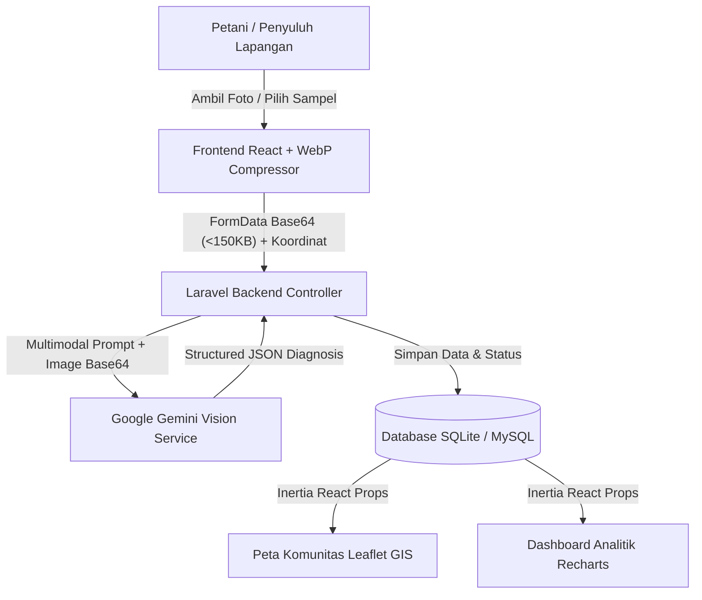

# TaniArang 🌱🪵

**Portal Data Residu Biomassa & Pemandu Konversi Biochar Pertanian Berbasis Multimodal AI Vision**

Inisiatif digital kategori **Web Application** untuk mendampingi petani dan kelompok tani (Poktan) menghentikan pembakaran terbuka (*open burning*) residu panen dan mengonversinya menjadi **Biochar** (arang aktif pertanian) penyubur tanah di sentra pertanian Jawa Timur dan Sulawesi Barat.

Dikembangkan untuk ajang **LOGICODIX 2026 Hackathon Competition** (Subtema: *Green Environment & Sustainability*).

---

## 📌 Daftar Isi
- [Latar Belakang & Masalah](#-latar-belakang--masalah)
- [Solusi: TaniArang](#-solusi-taniarang)
- [Fitur Utama](#-fitur-utama)
- [Arsitektur Sistem & Alur Kerja AI](#-arsitektur-sistem--alur-kerja-ai)
- [Dokumentasi Penggunaan AI](#-dokumentasi-penggunaan-ai)
- [Prinsip Desain & Engineering](#-prinsip-desain--engineering)
- [Tech Stack](#-tech-stack)
- [Panduan Instalasi & Menjalankan Proyek](#-panduan-instalasi--menjalankan-proyek)
- [Akun Demonstrasi & Akses Pengujian](#-akun-demonstrasi--akses-pengujian)
- [Pengujian (Testing)](#-pengujian-testing)
- [Struktur Direktori](#-struktur-direktori)
- [Atribusi & Sumber Data](#-atribusi--sumber-data)
- [Tim Pengembang](#-tim-pengembang)
- [Lisensi](#-lisensi)

---

## 🌾 Latar Belakang & Masalah

Di sentra lumbung pangan Indonesia (seperti Jawa Timur dan Sulawesi Barat), puluhan juta ton residu pertanian pascapanen kerap dibakar terbuka langsung di atas lahan sawah dan kebun:

1. **Degradasi Kesuburan Tanah**: Sekitar 70% lahan sawah intensif mengalami krisis bahan organik dengan kadar C-Organik kritis (< 2%), memicu ketergantungan pupuk kimia anorganik yang mahal.
2. **Krisis Iklim & Polusi Udara**: Pembakaran terbuka melepaskan emisi Karbon Monoksida (CO), Metana (CH4), dan partikulat berbahaya PM2.5 yang memicu penyakit pernapasan (ISPA) warga desa.
3. **Ketidaktahuan Teknis di Lapangan**: Petani dan penyuluh lapangan kekurangan rujukan visual cepat mengenai apakah limbah panennya sudah cukup kering untuk diolah serta langkah praktis pembuatan arang aktif tanpa modal tungku mahal.

**Target Pengguna:** Petani individu, pengurus Kelompok Tani (Poktan), penyuluh pertanian lapangan, serta pengelola sentra pirolisis komunitas.

---

## 💡 Solusi: TaniArang

**TaniArang** hadir sebagai jembatan teknologi rendah-karbon (*low-bandwidth Green IT*) yang menggabungkan:
- **Vision AI Multimodal (Google Gemini Vision)** untuk mendiagnosis jenis residu, kesiapan kekeringan, dan menghasilkan panduan pirolisis 3 langkah.
- **Sistem Informasi Geografis (GIS Leaflet Dark Matter)** untuk memetakan sebaran tumpukan biomassa komunitas petani (Poktan) dan memantau status pengolahannya.
- **Kokpit Data Agronomi Terbuka (Recharts)** berbasis rujukan Badan Standardisasi Instrumen Pertanian (BSIP / Balittanah), Kementerian Pertanian RI, dan BPS.

---

## 🚀 Fitur Utama

### 1. Pemindai Foto Residu Panen AI (`/scanner`)
- **Multimodal AI Analysis**: Mengidentifikasi komoditas limbah pertanian (Jerami Padi, Sekam Padi, Tongkol Jagung, Kulit Buah Kakao) dan kondisi kadar air (*Kering Siap Olah*, *Sedang - Jemur 1 Hari*, *Masih Basah - Perlu Dijemur 2 Hari*).
- **Green IT Image Compressor**: Kompresi gambar sisi klien (*client-side*) menggunakan HTML5 `<canvas>` menjadi format WebP beresolusi teroptimasi (maks. 768px, quality 0.72) untuk menghemat bandwidth internet pedesaan dan beban komputasi server.
- **4 Sampel Uji Cepat Lapangan**: Preset instan dari sentra Lamongan, Majene, Malang, dan Ngawi untuk demonstrasi dan evaluasi cepat.
- **Panduan 3 Langkah Pirolisis Ramah Petani**: Menghasilkan instruksi terstruktur teknik tungku tanah Kon-Tiki (*Top-Lit Updraft*) yang minim asap dan tidak memerlukan alat mahal.
- **Tangkapan Geolocation GPS**: Pengambilan koordinat GPS otomatis dengan validasi batas wilayah Indonesia.

### 2. Peta Sebaran Komunitas GIS (`/community-map`)
- **Peta Interaktif Carto Dark Matter**: Visualisasi titik dokumentasi kelompok tani mitra dengan pin status pengolahan (*Belum diolah*, *Sedang diproses*, *Selesai*).
- **Pintasan Kluster Regional**: Navigasi cepat wilayah sentra Jawa Timur (Lamongan, Ngawi, Malang) dan Sulawesi Barat (Majene, Polewali Mandar).
- **Filter & Pencarian Terpadu**: Penyaringan berdasarkan nama Poktan, desa, kabupaten, maupun jenis residu.
- **Tabel Log Terintegrasi**: Sinkronisasi dua arah antara marker peta dan tabel data dengan kemampuan pembaruan status dan *soft-delete / restore* data.

### 3. Dashboard Telemetri & Analitik Agronomi (`/`)
- **4 Kartu Telemetri Faktual**: Potensi residu regional (6,2 Juta Ton Jatim), rasio residu kulit kakao Sulbar (72,5%), statistik sawah kritis C-Organik (< 2%), dan titik data komunitas terdata.
- **Recharts Agricultural Cockpit**:
  - *Bar Chart*: Perbandingan timbulan limbah vs estimasi konversi biochar per kabupaten sentra.
  - *Donut Chart*: Proporsi jenis residu yang terdata di lapangan.
  - *Area Chart*: Tren penurunan lahan pembakaran terbuka vs adopsi lahan bersubsidi biochar.
- **Matriks 4 Karakteristik Komoditas**: Edukasi kandungan spesifik tiap residu (Silika sekam padi, Kalium kulit kakao, mikropori tongkol jagung, humat jerami padi).

### 4. Pusat Fakta & Katalog Biomassa (`/facts`)
- **Matriks Perbandingan Ilmiah**: Komparasi mendalam dampak pembakaran terbuka vs konversi biochar terhadap 4 aspek: Polusi udara, retensi air tanah kemarau, habitat mikroba penyubur, dan kapasitas tukar kation (KTK).
- **Katalog Spesifikasi Biomassa**: Filter wilayah untuk mengeksplorasi rasio konversi arang, kebutuhan suhu pirolisis, dan manfaat tanah per komoditas.

### 5. Portal Kemitraan & Kolaborasi (`/contact`)
- **Formulir Kemitraan**: Kanal khusus bagi Kelompok Tani (pendampingan), Kampus (riset laboratorium spektroskopi), dan CSR Perusahaan (penyaluran tungku pirolisis).
- **FAQ Interaktif**: Jawaban praktis seputar metode Kon-Tiki tanah, alasan pendekatan visual, dan bentuk kolaborasi.

---

## 🏗 Arsitektur Sistem & Alur Kerja AI



---

## 🤖 Dokumentasi Penggunaan AI

Aplikasi **TaniArang** mengintegrasikan **Google Gemini Vision API** pada fitur **Pemindai Foto Residu Panen AI (`/scanner`)**:

- **Layanan & Model AI:** Menggunakan **`gemini-3.5-flash-lite`** sebagai model utama dengan mekanisme estafet otomatis (*multi-model failover*) ke seri **Gemini 3 Flash** (`gemini-3.1-flash-lite`, `gemini-3.7-flash`, dan `gemini-3.8-flash`) guna menjaga ketersediaan layanan (*high availability*) saat terjadi kepadatan trafik API.
- **Tujuan Penggunaan:** Mengenali jenis residu biomassa pertanian (Jerami Padi, Sekam Padi, Tongkol Jagung, Kulit Buah Kakao) secara visual dari satu foto, mengestimasi kondisi kelembapan fisik, serta menyusun rekomendasi manfaat hara dan panduan pirolisis 3 langkah tanpa input manual yang rumit.
- **Alur Pemrosesan & Green IT:**
  1. Gambar yang diunggah dikompresi terlebih dahulu di browser klien menggunakan `<canvas>` ke format WebP (maks. 768px) agar hemat kuota internet pedesaan.
  2. Payload Base64 dikirim ke backend Laravel dan diproses oleh `App\Services\WasteVisionService` menggunakan `responseMimeType: "application/json"`.
  3. API mengembalikan keluaran *Structured JSON* yang divalidasi secara ketat (`is_valid_waste`, `detected_waste_type`, `moisture_condition`, `ai_confidence`, `ai_summary_recommendation`, dan `ai_Next_steps`) sebelum ditampilkan ke antarmuka dan disimpan ke database.
- **Transparansi & Etika AI:** Setiap hasil pemindaian menampilkan **AI Confidence Score (%)** secara terbuka, dan sistem menolak menampilkan data cadangan (*fallback*) seolah-olah hasil pemindaian *live* apabila koneksi API terganggu.

---

## 🎨 Prinsip Desain & Engineering

Frontend TaniArang dibangun dengan disiplin tinggi menggunakan integrasi 5 standar craft antarmuka:

1. **`ponytail`**: Kode ringkas, minimal diff, zero bloatware, mengutamakan kapabilitas standar HTML5/CSS dan utility Tailwind CSS asli tanpa script berlebih.
2. **`frontend-design`**: Estetika berakar kuat pada ranah agro-ekologi dan biochar (palet warna arang alami, daun segar, tanah subur, dan jingga panen), bukan template SaaS generik.
3. **`ui-ux-pro-max`**: Standar aksesibilitas WCAG AA (kontras rasio teks > 4.5:1, target sentuh minimal 44x44px, status fokus navigasi keyboard yang jelas, responsif mulai 375px mobile).
4. **`impeccable`**: Polesan interaksi profesional, pemisahan mode scannable untuk dashboard, serta penanganan lengkap untuk kondisi *Loading*, *Empty*, dan *Success*.
5. **`anti-slop`**: Bebas dari klise desain AI (tanpa border teks yang mengganggu, tanpa neon glow berlebih, tanpa tanda hubung em dash pada salinan UI, tanpa kartu-dalam-kartu bertumpuk, dan tanpa metrik palsu).

---

## 💻 Tech Stack

| Layer | Teknologi |
| :--- | :--- |
| **Backend Framework** | Laravel 11 / 12 (PHP 8.3+) |
| **Frontend Adapter** | Inertia.js v2 (React) |
| **UI Library** | React 18, Tailwind CSS v3 |
| **Visualisasi Data** | Recharts (Responsive SVG Charts) |
| **Sistem Geospasial** | Leaflet.js (CARTO Dark Matter Tiles) |
| **Ikonografi** | Lucide React |
| **Tipografi** | Plus Jakarta Sans (Modern Geometric Sans) & JetBrains Mono |
| **AI Model** | Google Gemini Vision (`gemini-3.5-flash-lite` dengan failover seri `gemini-3-flash`) |
| **Basis Data** | SQLite (Default Dev) / MySQL compatible |

---

## ⚙️ Panduan Instalasi & Menjalankan Proyek

### Prasyarat
Pastikan sistem Anda telah terpasang:
- **PHP** >= 8.2 (disarankan PHP 8.3 dengan ekstensi `pdo_sqlite`, `curl`, `mbstring`, `fileinfo`, `openssl`)
- **Composer** >= 2.x
- **Node.js** >= 18.x & **npm**

### Langkah Instalasi

1. **Clone Repositori**:
   ```bash
   git clone [https://github.com/mrd4n108/tani-arang.git](https://github.com/mrd4n108/tani-arang.git)
   cd tani-arang
   ```

2. **Instal Dependensi Backend (Composer)**:
   ```bash
   composer install
   ```

3. **Konfigurasi Environment**:
   ```bash
   cp .env.example .env
   php artisan key:generate
   ```

4. **Konfigurasi Variabel Lingkungan (`.env` / `.env.example`)**:
   Buka file `.env` dan pastikan variabel kunci berikut terisi:
   ```env
   APP_NAME=TaniArang
   APP_ENV=local
   APP_URL=[http://127.0.0.1:8000](http://127.0.0.1:8000)

   DB_CONNECTION=sqlite

   GEMINI_API_KEY=your_gemini_api_key_here
   GEMINI_MODEL=gemini-3.5-flash-lite
   ```
   *(Catatan: Aplikasi tetap menyediakan 4 preset sampel bawaan untuk pengujian cepat meskipun tanpa koneksi API eksternal)*.

5. **Migrasi, Seed Database & Storage Link**:
   ```bash
   touch database/database.sqlite
   php artisan migrate --seed
   php artisan storage:link
   ```

6. **Instal Dependensi Frontend & Build**:
   ```bash
   npm install
   npm run build
   ```

7. **Jalankan Server Lokal**:
   ```bash
   php artisan serve
   ```
   Buka peramban Anda di: **`http://127.0.0.1:8000`**

---

## 🔑 Akun Demonstrasi & Akses Pengujian

Seluruh fitur utama TaniArang (**Beranda Analitik**, **Pemindai Foto AI**, **Fakta & Biomassa**, **Peta Sentra**, dan **Hubungi Kami**) dapat langsung diakses dan diuji secara publik tanpa hambatan login.

Untuk menguji alur spesifik peran **Petani** dan **Sentra Komunitas** pada bagian riwayat dan verifikasi setoran, gunakan tombol pemilih peran cepat (*Role Switcher*) di bilah navigasi atas atau kredensial demo hasil *seeder* berikut:
- **Akun Petani:** `petani@taniarang.id` | Password: `password`
- **Akun Sentra Komunitas:** `komunitas@taniarang.id` | Password: `password`

---

## 🧪 Pengujian (Testing)

Proyek ini dilengkapi dengan Feature Tests otomatis dan perintah CLI pengujian AI Vision:

```bash
# Menjalankan seluruh automated feature tests
php artisan test

# Menguji pemindaian Gemini Vision API secara langsung di terminal
php artisan test:waste-vision jerami.jpg
```

Uji fitur otomatis yang dijalankan:
- `test_scanner_and_community_map_pages_render_successfully`
- `test_user_can_store_scan_log_and_redirect_to_community_map`
- `test_store_scan_validates_coordinates_and_required_fields`
- `test_can_update_processing_status_and_soft_delete_or_restore_scan`

---

## 📁 Struktur Direktori

```text
tani-arang/
├── app/
│   ├── Console/Commands/
│   │   └── TestWasteVision.php          # CLI command pengujian langsung Gemini Vision
│   ├── Http/Controllers/
│   │   └── TaniArangController.php      # Controller utama (Dashboard, Scanner, Map, Contact)
│   ├── Models/
│   │   ├── WasteScan.php                # Model data log pemindaian & lokasi Poktan
│   │   ├── WasteFact.php                # Model data komparasi & fakta biomassa
│   │   └── ContactMessage.php           # Model pesan kemitraan Poktan/CSR/Kampus
│   └── Services/
│       └── WasteVisionService.php       # Integrasi multimodal Google Gemini Vision API
├── database/
│   ├── migrations/                      # Skema tabel users, scans, facts, contacts
│   └── seeders/                         # Data awal regional Jatim & Sulbar
├── public/
│   └── samples/                         # 4 foto sampel residu pertanian untuk demo cepat
├── resources/
│   ├── css/
│   │   └── app.css                      # Custom dark scrollbar & Leaflet dark popup styling
│   ├── js/
│   │   ├── Components/                  # Komponen UI modular (Badge, Button, Card, StatCard)
│   │   ├── Layouts/
│   │   │   └── AppLayout.jsx            # Layout utama, navigasi responsif, flash alert
│   │   └── Pages/
│   │       ├── Dashboard.jsx            # Beranda & cockpit analitik Recharts
│   │       ├── Facts.jsx                # Matriks edukasi sains & katalog biomassa
│   │       ├── Scanner.jsx              # Pemindai foto AI & alur WebP compressor
│   │       ├── CommunityMap.jsx         # Peta GIS interaktif Leaflet Dark Matter
│   │       └── Contact.jsx              # Formulir kolaborasi & FAQ accordion
│   └── views/
│       └── app.blade.php                # HTML root view, fonts Plus Jakarta Sans
├── routes/
│   └── web.php                          # Definisi route aplikasi
├── tests/
│   └── Feature/                         # Automated feature & integration tests
└── tailwind.config.js                   # Konfigurasi palet tema alam & tipografi
```

---

## 📚 Atribusi & Sumber Data

- **Data Agronomi & Statistik Biomassa:** Badan Standardisasi Instrumen Pertanian (BSIP / Balittanah) Kementerian Pertanian RI, Badan Pusat Statistik (BPS), dan rujukan emisi *Intergovernmental Panel on Climate Change* (IPCC).
- **Layanan Peta & Geospasial:** [Leaflet.js](https://leafletjs.com/) dan basemap tiles oleh [CARTO Dark Matter](https://carto.com/basemaps/) & [OpenStreetMap](https://www.openstreetmap.org/copyright).
- **Layanan Kecerdasan Artifisial:** [Google Gemini API](https://ai.google.dev/).
- **Aset Ikonografi & Visualisasi:** [Lucide Icons](https://lucide.dev/), [Recharts](https://recharts.org/), dan fotografi sampel dokumentasi residu pertanian lapangan.

---

## 👥 Tim Pengembang

**Penduduk Asli Srikana:**

| Peran | Anggota & Akun GitHub | Tanggung Jawab Utama |
| :--- | :--- | :--- |
| **Developer 1 — Backend & Database Core System** | `[ANDI]` (`@mrd4n108`) | Arsitektur Laravel, skema database & seeder (`users`, `waste_facts`, `waste_scans`), autentikasi peran, API endpoint, dan deployment. |
| **Developer 2 — Frontend & UI/UX** | `[GUNTUR]` (`@dqrknessid`) | Implementasi antarmuka Inertia.js + React, Tailwind CSS, dashboard analitik Recharts, dan kompresor gambar sisi klien (Green IT). |
| **Developer 3 — AI Integration Specialist** | `[RASYANDRA]` (`@alvitodz`) | Integrasi Gemini Vision API (`WasteVisionService.php`), *prompt engineering*, validasi *Structured JSON*, *multi-model failover*, dan foto sampel uji. |
| **Developer 4 — Map, Log & Quality Assurance** | `[RAFA]` (`@rapapixel`) | Integrasi peta interaktif Leaflet.js, manajemen log dokumentasi kelompok tani, pengujian fitur otomatis, serta dokumentasi proyek. |

---

## 📄 Lisensi

Proyek ini dikembangkan di bawah lisensi terbuka [MIT License](LICENSE).
Inisiatif terbuka untuk mendukung keberlanjutan pertanian dan iklim Indonesia.