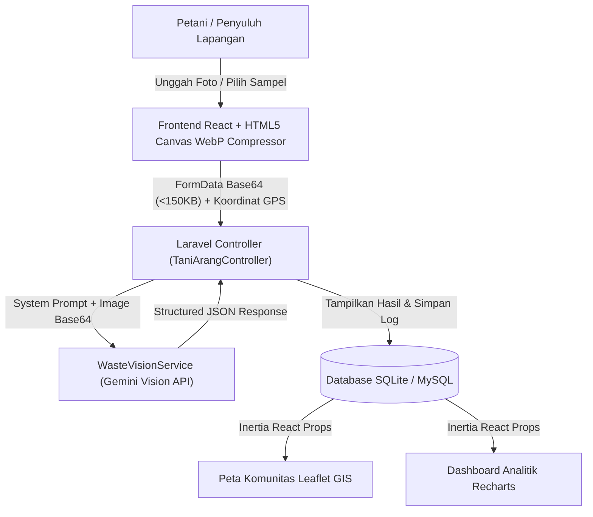

# TaniArang 🌱🪵

**Portal Data Residu Biomassa & Pemandu Konversi Biochar Pertanian Berbasis Multimodal AI Vision**

Inisiatif digital kategori **Web Application** untuk mendampingi petani dan kelompok tani (Poktan) menghentikan pembakaran terbuka (*open burning*) residu panen dan mengonversinya menjadi **Biochar** (arang aktif pertanian) penyubur tanah di sentra pertanian Jawa Timur dan Sulawesi Barat.

Dikembangkan untuk ajang **LOGICODIX 2026 Hackathon Competition** (Subtema: *Green Environment & Sustainability*).

---

## 📌 Daftar Isi
- [Pengenalan Projek](#-pengenalan-projek)
- [Fitur Utama](#-fitur-utama)
- [Technical Documentation (Arsitektur & Alur Sistem)](#-technical-documentation-arsitektur--alur-sistem)
- [Dokumentasi Penggunaan AI](#-dokumentasi-penggunaan-ai)
- [Frontend Documentation](#-frontend-documentation)
- [Backend Documentation](#-backend-documentation)
- [Petunjuk Instalasi & Menjalankan di Localhost](#-petunjuk-instalasi--menjalankan-di-localhost)
- [Akun Demonstrasi & Akses Pengujian](#-akun-demonstrasi--akses-pengujian)
- [Pengujian (Testing)](#-pengujian-testing)
- [Atribusi & Sumber Data](#-atribusi--sumber-data)
- [Tim Pengembang](#-tim-pengembang)
- [Lisensi](#-lisensi)

---

## 🌾 Pengenalan Projek

### Latar Belakang & Masalah
Di sentra lumbung pangan Indonesia (seperti Jawa Timur dan Sulawesi Barat), puluhan juta ton residu pertanian pascapanen kerap dibakar terbuka langsung di atas lahan sawah dan kebun:
1. **Degradasi Kesuburan Tanah**: Sekitar 70% lahan sawah intensif mengalami krisis bahan organik dengan kadar C-Organik kritis (< 2%), memicu ketergantungan pupuk kimia anorganik yang mahal.
2. **Krisis Iklim & Polusi Udara**: Pembakaran terbuka melepaskan emisi Karbon Monoksida (CO), Metana (CH4), dan partikulat berbahaya PM2.5 yang memicu penyakit pernapasan (ISPA) warga desa.
3. **Ketidaktahuan Teknis di Lapangan**: Petani dan penyuluh lapangan kekurangan rujukan visual cepat mengenai kesiapan kadar air limbah panen serta langkah praktis pembuatan arang aktif tanpa modal tungku mahal.

### Gambaran Solusi
**TaniArang** hadir sebagai platform web rendah-karbon (*low-bandwidth Green IT*) yang menggabungkan:
- **Multimodal AI Vision (Google Gemini Vision)** untuk mendiagnosis jenis residu panen dari satu foto, memeriksa tingkat kekeringan, dan menyajikan panduan pirolisis praktis 3 langkah.
- **Sistem Informasi Geografis (GIS Leaflet Dark Matter)** untuk memetakan sebaran tumpukan biomassa kelompok tani (Poktan) dan memantau status pengolahannya.
- **Kokpit Data Agronomi Terbuka (Recharts)** berbasis rujukan Badan Standardisasi Instrumen Pertanian (BSIP / Balittanah), Kementerian Pertanian RI, dan BPS.

### Target Pengguna
- **Petani Individu & Pengurus Kelompok Tani (Poktan):** Memindai limbah panen secara mandiri, melihat panduan pembuatan arang metode Kon-Tiki tanah, dan mencatat lokasi tumpukan biomassa.
- **Penyuluh Pertanian Lapangan (PPL) & Pengelola Sentra Komunitas:** Memantau sebaran potensi residu desa pada peta GIS dan memverifikasi status pengolahan biomassa.

---

## 🚀 Fitur Utama

1. **Pemindai Foto Residu Panen AI (`/scanner`)**:
   - Identifikasi visual otomatis 4 komoditas utama (*Jerami Padi*, *Sekam Padi*, *Tongkol Jagung*, *Kulit Buah Kakao*) beserta kondisi kadar air dan **AI Confidence Score (%)**.
   - **Green IT Image Compressor** sisi klien (WebP < 768px) + **4 Sampel Uji Cepat** untuk demonstrasi instan.
   - Panduan 3 langkah pirolisis ramah petani (*Kon-Tiki Top-Lit Updraft*) serta tangkapan koordinat GPS otomatis.
2. **Peta Sebaran Komunitas GIS (`/community-map`)**:
   - Peta interaktif *CARTO Dark Matter* dengan pin status pengolahan (*Belum diolah*, *Sedang diproses*, *Selesai*), filter kabupaten/komoditas, serta tabel log sinkron dua arah (*soft-delete* & *restore*).
3. **Dashboard Telemetri & Analitik Agronomi (`/`)**:
   - 4 kartu telemetri faktual, grafik perbandingan limbah vs potensi biochar (*Bar Chart*, *Donut Chart*, *Area Chart*), dan matriks kandungan unsur hara 4 komoditas.
4. **Pusat Fakta & Katalog Biomassa (`/facts`)**:
   - Matriks perbandingan ilmiah dampak pembakaran terbuka vs konversi biochar serta katalog spesifikasi suhu pirolisis per komoditas.
5. **Portal Kemitraan & Kolaborasi (`/contact`)**:
   - Kanal kolaborasi untuk Poktan, Kampus (riset spektroskopi), dan CSR penyaluran tungku pirolisis beserta FAQ interaktif.

---

## 🏗 Technical Documentation (Arsitektur & Alur Sistem)

TaniArang menggunakan arsitektur **Monolithic Web Application** (Laravel 11 + Inertia.js v2 + React 18) sehingga *backend* dan *frontend* berjalan terpadu dalam satu aplikasi tanpa overhead *microservice* berlebih.

### Diagram Alur Program & Pemrosesan AI


### Stack Teknologi Utama
| Layer | Teknologi | Keterangan |
| :--- | :--- | :--- |
| **Backend Framework** | Laravel 11 / 12 (PHP 8.3+) | Routing, validasi request, ORM Eloquent, HTTP Client |
| **Frontend Bridge** | Inertia.js v2 | Penghubung SPA React dengan controller Laravel tanpa REST terpisah |
| **UI & Styling** | React 18, Tailwind CSS v3 | Antarmuka responsif ringan (*Low-Bandwidth UI*) |
| **Visualisasi & Peta** | Recharts, Leaflet.js | Grafik statistik agronomi & peta GIS CARTO Dark Matter |
| **AI Vision Engine** | Google Gemini Vision API | Model `gemini-3.5-flash-lite` dengan failover seri `gemini-3-flash` |
| **Basis Data** | SQLite / MySQL | Penyimpanan data pengguna, fakta biomassa, log pindaian, dan kemitraan |

---

## 🤖 Dokumentasi Penggunaan AI

Aplikasi **TaniArang** mengintegrasikan **Google Gemini Vision API** pada fitur **Pemindai Foto Residu Panen AI (`/scanner`)**:
- **Model Utama & Failover:** Menggunakan **`gemini-3.5-flash-lite`** sebagai model utama dengan mekanisme estafet otomatis (*multi-model failover*) ke seri **Gemini 3 Flash** (`gemini-3.1-flash-lite`, `gemini-3.7-flash`, dan `gemini-3.8-flash`) guna menjaga ketersediaan layanan (*high availability*).
- **Tujuan Penggunaan:** Mengenali jenis residu pertanian secara visual dari satu foto, mengestimasi kondisi kelembapan fisik, serta menyusun rekomendasi manfaat hara dan panduan pirolisis 3 langkah.
- **Kontrak Structured JSON (`App\Services\WasteVisionService`):** Menggunakan konfigurasi `responseMimeType: "application/json"` yang mengembalikan kunci tervalidasi: `is_valid_waste`, `detected_waste_type`, `moisture_condition`, `ai_confidence`, `ai_summary_recommendation`, dan `ai_Next_steps`.
- **Transparansi & Etika AI:** Setiap hasil pemindaian menampilkan **AI Confidence Score (%)** secara terbuka, dan sistem menolak menampilkan data cadangan (*fallback*) seolah-olah hasil pemindaian *live* apabila koneksi API terganggu.

---

## 🎨 Frontend Documentation

### Framework & Library Antarmuka
- **Framework:** React 18 (terintegrasi melalui `@inertiajs/react` dan dibundel menggunakan **Vite**).
- **Styling & Tipografi:** Tailwind CSS v3 dengan palet warna agro-ekologi gelap (*Charcoal*, *Leaf Green*, *Harvest Amber*), font **Plus Jakarta Sans** & **JetBrains Mono**, serta ikonografi **Lucide React**.
- **Prinsip Craft:** Menerapkan standar aksesibilitas WCAG AA (kontras > 4.5:1, target sentuh minimal 44x44px, responsif mulai lebar layar 375px).

### Struktur Komponen UI
```text
resources/
├── css/
│   └── app.css                      # Konfigurasi Tailwind, custom dark scrollbar & popup Leaflet
├── js/
│   ├── Components/                  # Komponen UI modular yang dapat digunakan ulang
│   │   ├── Badge.jsx                # Lencana status kekeringan, AI confidence & Green IT
│   │   ├── Button.jsx               # Tombol aksi standar dengan status loading/disabled
│   │   ├── Card.jsx                 # Kontainer kartu informasi utama
│   │   └── StatCard.jsx             # Kartu metrik telemetri agronomi pada Beranda
│   ├── Layouts/
│   │   └── AppLayout.jsx            # Kerangka navigasi responsif, role switcher & notifikasi flash
│   └── Pages/                       # Halaman utama aplikasi (Inertia Pages)
│       ├── Dashboard.jsx            # Beranda & grafik analitik Recharts
│       ├── Scanner.jsx              # Pemindai foto AI, kompresor WebP & panduan Kon-Tiki
│       ├── CommunityMap.jsx         # Peta GIS Leaflet & tabel log dokumentasi Poktan
│       ├── Facts.jsx                # Matriks edukasi ilmiah & katalog spesifikasi biomassa
│       └── Contact.jsx              # Formulir kemitraan Poktan/Kampus/CSR & FAQ
└── views/
    └── app.blade.php                # Template root HTML & pemuatan aset Vite
```

### Aset & Optimasi Green IT
- **Kompresor Gambar Sisi Klien (`Scanner.jsx`):** Menggunakan HTML5 `<canvas>` untuk mengubah ukuran foto maksimal `768px` dan mengonversinya menjadi format `image/webp` (`quality: 0.72`) sebelum dikirim ke server, sehingga ukuran payload menyusut hingga < 150 KB.
- **Sampel Foto Lapangan (`public/samples/`):** Menyediakan 4 aset gambar uji cepat (`jerami.jpg`, `sekam.jpg`, `tongkol-jagung.jpg`, `kulit-kakao.jpg`) untuk demonstrasi instan tanpa bergantung pada unggahan eksternal.
- **Tile Peta:** Menggunakan *CARTO Dark Matter* raster tiles melalui Leaflet.js untuk meminimalkan beban rendering vektor di perangkat spesifikasi rendah.

---

## ⚙️ Backend Documentation

### Daftar API & Web Endpoints (`routes/web.php`)
| Method | Endpoint | Controller Method | Deskripsi & Payload |
| :--- | :--- | :--- | :--- |
| `GET` | `/` | `TaniArangController@dashboard` | Menampilkan halaman Beranda, statistik regional, dan grafik agronomi. |
| `GET` | `/scanner` | `TaniArangController@scanner` | Menampilkan halaman Pemindai Foto AI dan daftar preset sampel. |
| `POST` | `/scanner/analyze` | `TaniArangController@analyzeScan` | Menerima `FormData` (`image_base64` atau `preset_key`), memanggil `WasteVisionService`, dan mengembalikan respons JSON terstruktur. |
| `POST` | `/scanner/store` | `TaniArangController@storeScan` | Menyimpan hasil pemindaian AI, nama Poktan, lokasi desa, dan koordinat GPS ke tabel `waste_scans`. |
| `GET` | `/community-map` | `TaniArangController@communityMap` | Menampilkan peta GIS Leaflet dan tabel log dokumentasi residu Poktan. |
| `PATCH` | `/community-map/{scan}/status` | `TaniArangController@updateStatus` | Memperbarui status pengolahan (`Belum diolah`, `Sedang diproses`, `Selesai`). |
| `DELETE` | `/community-map/{scan}` | `TaniArangController@destroyScan` | Melakukan *soft-delete* pada log dokumentasi pemindaian. |
| `POST` | `/community-map/{scan}/restore` | `TaniArangController@restoreScan` | Memulihkan data log yang telah di-*soft-delete*. |
| `GET` | `/facts` | `TaniArangController@facts` | Menampilkan matriks perbandingan pembakaran vs biochar dan katalog biomassa. |
| `GET` | `/contact` | `TaniArangController@contact` | Menampilkan halaman portal kemitraan dan FAQ. |
| `POST` | `/contact` | `TaniArangController@storeContact` | Menyimpan pengajuan kemitraan dari Poktan, Kampus, atau CSR ke tabel `contact_messages`. |

### Database Schema
Struktur basis data dirancang ringkas dalam 4 tabel migrasi (`database/migrations/`):

1. **`users`** (Data Pengguna & Peran)
   - `id` (PK), `name`, `email` (Unique), `password`, `role` (`admin` / `petani`), `region`, `timestamps`.
2. **`waste_facts`** (Referensi Ilmiah & Spesifikasi Biomassa)
   - `id` (PK), `waste_name`, `region_focus`, `annual_volume_fact`, `burning_hazard_fact`, `biochar_benefit_fact`, `processing_steps` (JSON), `nutrient_facts` (JSON), `timestamps`.
3. **`waste_scans`** (Log Pemindaian AI & Titik Peta Komunitas)
   - `id` (PK), `user_id` (FK -> `users.id`), `farmer_group_name`, `village_location`, `latitude` (Decimal), `longitude` (Decimal), `image_path`, `detected_waste_type`, `moisture_condition`, `ai_confidence` (Integer), `ai_summary_recommendation` (Text), `ai_Next_steps` (JSON), `processing_status`, `deleted_at` (SoftDeletes), `timestamps`.
4. **`contact_messages`** (Pesan Kemitraan & Kolaborasi)
   - `id` (PK), `name`, `organization`, `partner_type`, `email`, `message`, `timestamps`.

### Konfigurasi `.env.example`
Repositori menyertakan file `.env.example` tanpa kredensial rahasia untuk menjaga keamanan kunci API:
```env
APP_NAME=TaniArang
APP_ENV=local
APP_KEY=
APP_DEBUG=true
APP_URL=http://127.0.0.1:8000

DB_CONNECTION=sqlite
# DB_HOST=127.0.0.1
# DB_PORT=3306
# DB_DATABASE=tani_arang
# DB_USERNAME=root
# DB_PASSWORD=

SESSION_DRIVER=file
CACHE_STORE=file
FILESYSTEM_DISK=local

GEMINI_API_KEY=
GEMINI_MODEL=gemini-3.5-flash-lite
```

---

## 💻 Petunjuk Instalasi & Menjalankan di Localhost

### Prasyarat Sistem
Pastikan perangkat telah terpasang:
- **PHP** >= 8.2 (disarankan PHP 8.3 dengan ekstensi `pdo_sqlite`, `curl`, `mbstring`, `fileinfo`, `openssl`)
- **Composer** >= 2.x
- **Node.js** >= 18.x & **npm**

### Langkah Instalasi & Eksekusi Lokal

1. **Clone Repositori**:
   ```bash
   git clone https://github.com/mrd4n108/tani-arang.git
   cd tani-arang
   ```

2. **Instal Dependensi Backend (PHP / Composer)**:
   ```bash
   composer install
   ```

3. **Salin Konfigurasi Environment & Buat Application Key**:
   ```bash
   cp .env.example .env
   php artisan key:generate
   ```

4. **Isi API Key Gemini pada File `.env`**:
   Buka file `.env` dan masukkan kunci API Google Gemini Anda (dapatkan gratis melalui Google AI Studio):
   ```env
   GEMINI_API_KEY=isi_dengan_api_key_gemini_anda
   GEMINI_MODEL=gemini-3.5-flash-lite
   ```
   *(Catatan: Aplikasi tetap menyediakan 4 sampel uji cepat bawaan meskipun tanpa koneksi API eksternal)*.

5. **Siapkan Database SQLite, Migrasi, Seeder & Storage Link**:
   ```bash
   touch database/database.sqlite
   php artisan migrate --seed
   php artisan storage:link
   ```

6. **Instal Dependensi Frontend & Kompilasi Aset**:
   ```bash
   npm install
   npm run build
   ```

7. **Jalankan Server Localhost**:
   ```bash
   php artisan serve
   ```
   Buka browser dan akses alamat: **`http://127.0.0.1:8000`**

---

## 🔑 Akun Demonstrasi & Akses Pengujian

Seluruh fitur utama TaniArang (**Beranda Analitik**, **Pemindai Foto AI**, **Fakta & Biomassa**, **Peta Sentra**, dan **Hubungi Kami**) dapat langsung diakses dan diuji secara publik tanpa hambatan login.

Untuk menguji alur spesifik peran **Petani** dan **Sentra Komunitas**, gunakan tombol pemilih peran cepat (*Role Switcher*) di bilah navigasi atas atau kredensial demo hasil *seeder* berikut:
- **Akun Petani:** `petani@taniarang.id` | Password: `password`
- **Akun Sentra Komunitas:** `komunitas@taniarang.id` | Password: `password`

---

## 🧪 Pengujian (Testing)

```bash
# Menjalankan seluruh automated feature tests Laravel
php artisan test

# Menguji pemindaian Gemini Vision API secara langsung di terminal
php artisan test:waste-vision jerami.jpg
```

---

## 📚 Atribusi & Sumber Data

- **Data Agronomi & Statistik Biomassa:** Badan Standardisasi Instrumen Pertanian (BSIP / Balittanah) Kementerian Pertanian RI, Badan Pusat Statistik (BPS), dan rujukan emisi *Intergovernmental Panel on Climate Change* (IPCC).
- **Layanan Peta & Geospasial:** [Leaflet.js](https://leafletjs.com/) dan basemap tiles oleh [CARTO Dark Matter](https://carto.com/basemaps/) & [OpenStreetMap](https://www.openstreetmap.org/copyright).
- **Layanan Kecerdasan Artifisial:** [Google Gemini API](https://ai.google.dev/).
- **Aset Ikonografi & Visualisasi:** [Lucide Icons](https://lucide.dev/), [Recharts](https://recharts.org/), dan fotografi sampel dokumentasi residu pertanian lapangan (`public/samples/`).

---

## 👥 Tim Pengembang

**Nama Tim:** `Penduduk Asli Srikana`

| Peran | Anggota & Akun GitHub | Tanggung Jawab Utama |
| :--- | :--- | :--- |
| **Developer 1 — Backend & Database Core System** | `[M. Ramdani]` (`@mrd4n108`) | Arsitektur Laravel, skema database & seeder, autentikasi peran, API endpoint, dan deployment. |
| **Developer 2 — Frontend & UI/UX** | `[Guntur]` (`@dqrknessid`) | Implementasi antarmuka Inertia.js + React, Tailwind CSS, dashboard Recharts, dan kompresor WebP sisi klien. |
| **Developer 3 — AI Integration Specialist** | `[Rasyandra Alvito]` (`@alvitodz`) | Integrasi Gemini Vision API (`WasteVisionService.php`), *prompt engineering*, validasi *Structured JSON*, *multi-model failover*, dan foto sampel uji. |
| **Developer 4 — Map, Log & Quality Assurance** | `[Rafa]` (`@rapapixel`) | Integrasi peta interaktif Leaflet.js, manajemen log dokumentasi Poktan, pengujian fitur otomatis, serta dokumentasi proyek. |

---

## 📄 Lisensi

Proyek ini dikembangkan di bawah lisensi terbuka [MIT License](LICENSE).
Inisiatif terbuka untuk mendukung keberlanjutan pertanian dan iklim Indonesia.
